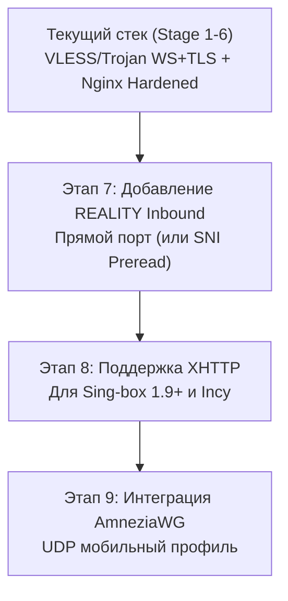

# Архитектурный анализ и стратегия транспортной диверсификации Sing-box

> Документ подготовлен в рамках комплексного технического аудита и модернизации проекта `tgproxy-vpsvless-tgbot`.

---

## 1. Введение и оценка текущего транспортного стека

В текущей архитектуре проекта основными транспортами являются:
1. **VLESS over WebSocket + TLS** (reverse proxy через Nginx на порт `11443`).
2. **Trojan over WebSocket + TLS** (reverse proxy через Nginx на порт `10443`).
3. **Telegram Web Proxy** (`tproxy-server` в Docker через Nginx reverse proxy на порт `8080`).

### Сильные стороны текущей схемы:
* **Единый порт 443 для всех сервисов**: Nginx маршрутизирует трафик по URL-путям (`/{{VLESS_PATH}}`, `/{{TROJAN_PATH}}`, `/{{SUBS_PATH}}`, `/` для decoy-сайта).
* **Полноценный Decoy Portfolio**: при обращении к корню отдаётся легитимный веб-сайт с кодом `200 OK`, защищающий от примитивных сканеров.
* **Совместимость со старыми клиентами**: WebSocket поддерживается практически всеми клиентами (v2rayN, Shadowrocket, Streisand, старые версии Sing-box).

### Ограничения протокола WebSocket при глубоком анализе пакетов:
1. **Специфика заголовков WebSocket**:
   * При установлении соединения клиент отправляет характерный HTTP/1.1 запрос с заголовками `Upgrade: websocket` и `Connection: Upgrade`.
   * При анализе метаданных корпоративные шлюзы и сетевые фильтры детектируют долгие непрерывные WebSocket-сессии с асимметричным трафиком.
2. **Сигнатура TLS-in-TLS**:
   * При передаче шифрованного трафика внутри внешнего TLS-туннеля (до вашего Nginx) передаются внутренние TLS Client Hello.
   * Это создаёт чёткий маркер структуры пакетов: наличие TLS Record Layer внутри зашифрованного WS-фрейма.
3. **Зависимость от доменного имени и Let's Encrypt**:
   * При сетевой недоступности доменного имени или фильтрации по SNI все сервисы, завязанные на один сертификат, могут испытывать перебои.
4. **Накладные расходы и задержка**:
   * Трафик проходит цепочку: `Клиент -> TCP Handshake -> TLS Handshake -> HTTP Upgrade -> Nginx Core -> Local Socket -> Sing-box Inbound`. Это увеличивает RTT и снижает пропускную способность по сравнению с прямыми транспортами.

---

## 2. Матрица сравнительного анализа протоколов

| Протокол / Транспорт | Устойчивость к сетевой фильтрации | Активное зондирование | Оверхед по RTT | Нужен ли домен/SSL | Совместимость с клиентами |
| :--- | :---: | :---: | :---: | :---: | :---: |
| **VLESS + WS + TLS** *(Текущий)* | ⚠️ Средняя (сигнатура WS) | 🟢 Высокая (decoy 200 OK) | 🔴 Высокий (+2 RTT) | Да (Let's Encrypt) | 🟢 99% всех клиентов |
| **VLESS + REALITY + Vision** | 🛡️ Максимальная (XTLS-Vision) | 🛡️ Абсолютная (валидный TLS) | 🟢 Минимальный (0 RTT TLS 1.3) | ❌ Нет (прямой SNI) | 🟢 Sing-box, Incy, Happ, v2rayN |
| **VLESS + XHTTP (SplitHTTP)** | 🟢 Высокая (эмуляция H2/H3 потоков) | 🟢 Высокая (через Nginx/CDN) | 🟡 Средний | Да | 🟡 Sing-box 1.9+, Incy |
| **AmneziaWG (AWG)** | 🛡️ Высокая для UDP | 🟢 Высокая (рандомизация) | 🟢 Нулевой (UDP) | ❌ Нет | 🟡 Amnezia, Happ |
| **Hysteria 2 / TUIC v5** | 🟢 Высокая на нестабильных сетях | 🟡 Средняя | 🟢 Нулевой (UDP BBR) | Да / Self-signed | 🟢 Sing-box, Happ, Clash Meta |

---

## 3. Рекомендуемые направления модернизации

### 3.1. VLESS с XTLS-REALITY и Flow `xtls-rprx-vision` (Приоритет 1)
REALITY оптимизирует обработку сертификатов и защиту от неавторизованного сетевого сканирования:
* **Как работает**: сервер направляет неавторизованные запросы на fallback-хост. При активном зондировании сервер отдаёт реальный сертификат и handshake целевого сайта.
* **XTLS Vision**: устраняет сигнатуру TLS-in-TLS. При передаче TLS-трафика внутри туннеля Vision передаёт сырой TLS без дополнительного шифрования и оверхеда, делая пакеты неотличимыми от прямого браузерного сеанса.

#### 3.1.1. Эволюция к Self-SNI (Принцип честного домена и авторский сайт студии дизайна `ORBITA // DESIGN LAB`)
Классический подход REALITY с «заимствованием» сторонних SNI (`apple.com`, `microsoft.com`) имеет архитектурную уязвимость: **несоответствие автономной системы (ASN) и IP-адреса**. Если заявляемый SNI принадлежит крупной корпорации, а IP-адрес относится к независимому дата-центру, автоматические анализаторы маршрутов фиксируют аномалию.

В нашей архитектуре реализован **Self-SNI**:
* **SNI указывает на собственный домен узла** (`node.yourdomain.com`), для которого выпущен валидный сертификат Let's Encrypt.
* **Fallback направлен на локальный веб-сервер Nginx** (`127.0.0.1:443`), где развёрнут авторский сайт студии пространственного дизайна **ORBITA // DESIGN LAB** (космический визуал, 60fps Canvas-звездопад, 100/100 в Lighthouse, реальные кейсы и чистый код без сторонних тяжелых фреймворков).
* **Результат**: IP-адрес на 100% совпадает с DNS, TLS-сертификат легитимен, а при HTTP-запросе открывается реальный дизайнерский сайт. Полная консистентность сетевой конфигурации.

#### Пример конфигурации Inbound Sing-box (REALITY):
```json
{
  "type": "vless",
  "tag": "vless-reality-in",
  "listen": "0.0.0.0",
  "listen_port": 443,
  "sniff": true,
  "sniff_override_destination": true,
  "users": [
    {
      "uuid": "<UUID>",
      "flow": "xtls-rprx-vision"
    }
  ],
  "tls": {
    "enabled": true,
    "server_name": "dl.google.com",
    "reality": {
      "enabled": true,
      "handshake": {
        "server": "dl.google.com",
        "port": 443
      },
      "private_key": "<PRIVATE_KEY>",
      "short_id": ["<SHORT_ID_HEX>"]
    }
  }
}
```

### 3.2. Транспорт XHTTP (SplitHTTP) через Nginx / CDN (Приоритет 2)
Для сценариев, когда требуется работа через CDN (Cloudflare) или строгие HTTP/2 / HTTP/3 корпоративные прокси:
* В Sing-box 1.9+ представлен протокол XHTTP (SplitHTTP), который разделяет входящий и исходящий потоки на стандартизированные HTTP-запросы (POST/GET с чанками).
* В отличие от WebSocket, XHTTP полностью мультиплексируется в рамках одного HTTP/2 или HTTP/3 (QUIC) соединения, не вызывая подозрений у анализаторов трафика.

### 3.3. Обфусцированный UDP (AmneziaWG / Shadowsocks-2022) (Приоритет 3)
Для мобильного трафика, где важна устойчивость при смене сетей (Wi-Fi ↔ LTE) и минимальная задержка (игры, звонки):
* Стандартный протокол WireGuard легко классифицируется сигнатурными анализаторами по фиксированному размеру первого пакета рукопожатия (Init packet 148 байт).
* **AmneziaWG** добавляет случайные байты в заголовок и тело пакетов (`Jmin`, `Jmax`, `Jc`, `S1`, `S2`), предотвращая статическую сигнатурную классификацию.

---

## 4. План поэтапной интеграции (Migration Roadmap)



1. **Сохранение обратной совместимости**:
   * Существующие профили VLESS-WS и Trojan-WS продолжают работать через Nginx для старых клиентов.
2. **Генерация мультипрофильных подписок**:
   * Telegram-бот генерирует подписку, содержащую сразу несколько outbounds:
     * `[VLESS-REALITY] Высокая скорость (Основной)`
     * `[VLESS-WS-TLS] Резервный через Nginx`
     * `[Trojan-WS-TLS] Альтернативный порт`
   * Клиент (Sing-box / Incy / Happ) автоматически использует URLTest для выбора самого быстрого и доступного узла.
